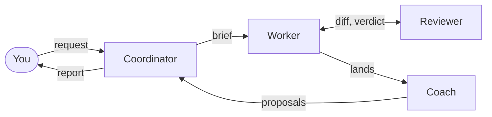

# Agent Skills

> Engineering skills for coding agents: the workflow from brief to release, compatible with [agentskills.io](https://agentskills.io)

[](https://github.com/cniska/agent-skills/actions/workflows/ci.yml?query=branch%3Amain)
[](LICENSE)

I do all my engineering with coding agents, and this is the workflow I follow. The skills are opinionated, based on 15+ years of building production software.

Two parts carry the workflow:

- **[task](skills/workflow/task/SKILL.md) routes each task** by what it changes (feature, bug fix, refactor, test or review), and loads the skill each step needs.
- **[A separate reviewer](docs/reviewer.md) judges every commit** against my design rules in [design-review](skills/expertise/design-review/SKILL.md).

Inspired by [addyosmani/agent-skills](https://github.com/addyosmani/agent-skills); routes adapted from [pstack](https://github.com/cursor/plugins/tree/main/pstack), the plugin from [superpowers](https://github.com/obra/superpowers).

## Three loops

- **The inner loop is one task:** [task](skills/workflow/task/SKILL.md) takes it from request to landed branch, step by step.
- **The outer loop is all the work:** [coordinate](skills/workflow/coordinate/SKILL.md) hands each task to an agent running the inner loop, keeps the agents moving, and asks me only what it cannot answer.
- **The improvement loop changes the workflow:** the coach reviews each task once it lands, and the coordinator applies each change it proposes as an experiment where a signal can read it, kept or reverted by the [signals](docs/loops.md#signals): counts of friction, such as how often I had to step in.

One task's life, from my request through its landed branch to the workflow changes its coach proposes:



The [outer loop chart](docs/loops.md#the-outer-loop) adds the ledger, the experiments and their check dates.

## Install

Once installed, [how a task runs](docs/loops.md#how-a-task-runs) says how to start a task and which route each kind of task takes.

### Claude Code

Install the `cniska-skills` plugin, which bundles every skill with [the hooks and agents](#the-plugin):

```
claude plugin marketplace add cniska/agent-skills
claude plugin install cniska-skills@cniska
```

- An installed plugin is a copy of the commit it was installed from, and `claude plugin update cniska-skills@cniska --scope user` brings it up to the marketplace's latest; a project-scope install takes `--scope project`, run from that project.
- To try it for one session from a checkout, run `claude --plugin-dir .`.
- Skills also installed through `npx skills add` show up a second time without the prefix, so use one or the other.
- The plugin's hooks need `jq`.

### Other agents

```
npx skills add cniska/agent-skills
```

## The plugin

[The plugin](docs/plugin.md) has the detail on each part and on its optional companions.

| Part | What it does for you |
|---|---|
| Session-start hook | Routes a plain prompt the way `/task` would. |
| Reviewer agent | Judges each commit it did not write against the design rules, runs `review` on a whole branch before it lands, and ends with accept or return. |
| Commit gate | Holds each commit for the reviewer's accept. |
| Ledger hook | Prints the coordinator's ledger, and the shared file it links, into each session, so coordinating work survives restarts and compaction. |
| Coach agent | Coaches each task once it lands, proposing the workflow changes that repeat. |
| Task coach hook | Runs the coach when a delegated task ends. |
| Event log | Records gate decisions, verdicts with their finding counts and permission prompts, for [agent-record](https://github.com/cniska/agent-record) to archive where installed. |

## Skills

### Workflow skills

Steps that produce an output; one that goes unused is fixed or dropped.

| Skill | Description |
|-------|------------|
| [task](skills/workflow/task/SKILL.md) | Pick a route by what the task changes and load each step's skill |
| [coordinate](skills/workflow/coordinate/SKILL.md) | Run work across agents and repos from a ledger, asking the owner only what it cannot answer |
| [plan](skills/workflow/plan/SKILL.md) | Design through dialogue, slice vertically |
| [spec](skills/workflow/spec/SKILL.md) | State what to build, not how; labelled, traceable requirements |
| [build](skills/workflow/build/SKILL.md) | Cut work into slices, take a brief's slices in order, and stop where the plan runs out |
| [tdd](skills/workflow/tdd/SKILL.md) | Red-green-refactor, one test at a time |
| [debug](skills/workflow/debug/SKILL.md) | Stop the line, reproduce, fix root cause, guard with test |
| [refactor](skills/workflow/refactor/SKILL.md) | Refactor or rewrite so the new design copies nothing from the old |
| [simplify](skills/workflow/simplify/SKILL.md) | Reduce complexity, Chesterton's Fence, preserve behavior |
| [deprecation](skills/workflow/deprecation/SKILL.md) | Build replacement first, migrate consumers, remove completely |
| [git](skills/workflow/git/SKILL.md) | Conventional commits, rebase to sync, squash to land |
| [pr](skills/workflow/pr/SKILL.md) | Self-review gated PR create or description update |
| [ship](skills/workflow/ship/SKILL.md) | Pre-release gate, version bump from commits, cut the tag, verify every channel |
| [review](skills/workflow/review/SKILL.md) | Correctness and tests on a whole branch or PR, and each other area the diff touches |
| [audit](skills/workflow/audit/SKILL.md) | All review dimensions on existing code, read-only, with per-dimension coverage |
| [explain-diff](skills/workflow/explain-diff/SKILL.md) | Explain a diff's intent and risk in the session |
| [second-opinion](skills/workflow/second-opinion/SKILL.md) | Have a different model attack a consequential call or a document's facts |
| [issue](skills/workflow/issue/SKILL.md) | File a GitHub issue — check duplicates, draft, get approval |
| [why](skills/workflow/why/SKILL.md) | Trace recorded design rationale and check whether it still applies |
| [search-sessions](skills/workflow/search-sessions/SKILL.md) | Find what a past session said and decided, quoted and cited; asks [agent-record](https://github.com/cniska/agent-record) first where it is installed |
| [adr](skills/workflow/adr/SKILL.md) | Record an important technical decision by the problem it solves, current state only |
| [docs-writing](skills/workflow/docs-writing/SKILL.md) | Create or update project documentation: each claim checked at its source, each fact in the doc that owns it, every mention of a changed behavior swept |
| [agents-md](skills/workflow/agents-md/SKILL.md) | Create or update AGENTS.md project rules |
| [skill-writing](skills/workflow/skill-writing/SKILL.md) | Create or update a skill — clone the closest sibling, keep project specifics out, reach for an eval only when the change's risk needs one, then check it in real use |
| [routine-writing](skills/workflow/routine-writing/SKILL.md) | Write a scheduled, unattended agent run: the file as the source, hard limits, loud failures, a probe and a manual run before it runs alone |
| [verification-setup](skills/workflow/verification-setup/SKILL.md) | Create or update a project skill that drives and inspects the running app |
| [workflow-review](skills/workflow/workflow-review/SKILL.md) | Turn how the work actually went into proposed changes to skills, agents and repo rules, each backed by two sessions of quoted evidence and named by the waste it cost and its cause |

### Expertise skills

What good looks like in one kind of work, which may go unused for a while.

| Skill | Description |
|-------|------------|
| [principles](skills/expertise/principles/SKILL.md) | The principles more than one skill applies, one file each, read by name |
| [code-writing](skills/expertise/code-writing/SKILL.md) | Shared code rules once, plus a toolchain and pitfalls reference per language |
| [test-writing](skills/expertise/test-writing/SKILL.md) | Tests that catch a named bug, proven able to fail |
| [writing](skills/expertise/writing/SKILL.md) | Write clear, natural prose for each reader and medium, and the shared rules for documents that last |
| [database-design](skills/expertise/database-design/SKILL.md) | Schema as the domain's record: invariants, access, and migrations in the database |
| [ui-design](skills/expertise/ui-design/SKILL.md) | Design or review interfaces against product states and visual hierarchy |
| [design-review](skills/expertise/design-review/SKILL.md) | Judge code against design rules; trace a module's bugs to its design, cuts first |
| [correctness-review](skills/expertise/correctness-review/SKILL.md) | Logic bugs, edge cases, broken contracts |
| [maintainability-review](skills/expertise/maintainability-review/SKILL.md) | Conformance to local conventions, naming and readability |
| [architecture-review](skills/expertise/architecture-review/SKILL.md) | Conformance to the project's stated boundaries, dependency direction and contracts |
| [security-review](skills/expertise/security-review/SKILL.md) | Trust boundaries, execution safety, concrete attack paths only |
| [performance-review](skills/expertise/performance-review/SKILL.md) | Repeated work, unbounded operations, and resource use |
| [test-review](skills/expertise/test-review/SKILL.md) | Coverage gaps, edge cases, test quality |
| [doc-review](skills/expertise/doc-review/SKILL.md) | Drift detection, terminology, outdated names |

## Docs

- [The loops](docs/loops.md): how a task runs, the outer loop and the improvement loop.
- [The reviewer](docs/reviewer.md): how each commit is judged.
- [The plugin](docs/plugin.md): each hook and agent, and the optional companions.
- [Conventions](docs/conventions.md): how a skill is written, model tiers and principles.
- [How I maintain these](docs/maintaining.md): what I add and remove, and why.
- [Development](docs/development.md): setup, checks, layout and rules for working on this repo.

## License

MIT
