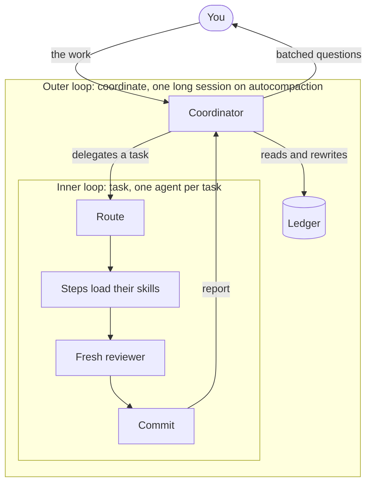
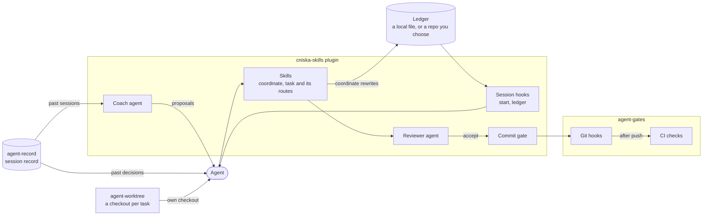
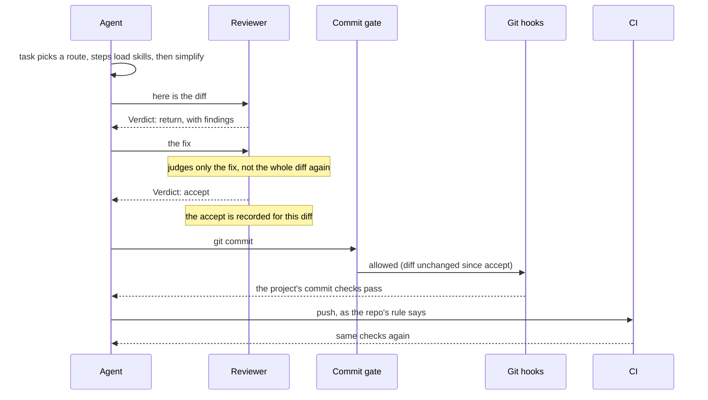

# Agent Skills

Engineering skills for AI coding agents, compatible with [agentskills.io](https://agentskills.io).

I do all my engineering with coding agents, and these skills encode the workflow I follow. They are opinionated, based on 15+ years of building production software.

Two parts carry the workflow:

- **[task](skills/task/SKILL.md) routes each task.** It picks a route by what the task changes and loads the skill each step needs.
- **[A separate reviewer](#the-reviewer) judges every commit** against my design rules in [design-review](skills/design-review/SKILL.md).

Builds on [addyosmani/agent-skills](https://github.com/addyosmani/agent-skills); routes adapted from [pstack](https://github.com/cursor/plugins/tree/main/pstack), the plugin from [superpowers](https://github.com/obra/superpowers).

## Two loops

- **The inner loop is one task.** [task](skills/task/SKILL.md) takes it from request to landed commit, step by step, as [how a task runs](#how-a-task-runs) shows.
- **The outer loop is all the work.** [coordinate](skills/coordinate/SKILL.md) hands each task to an agent running the inner loop, keeps the agents moving, and asks me only what needs me. It keeps its state in a [ledger](#the-plugin), so one long session can run on autocompaction.



## Install

### Claude Code

Install the `cniska-skills` plugin, which bundles every skill with the hooks and the agents described in [the plugin](#the-plugin):

```
claude plugin marketplace add cniska/agent-skills
claude plugin install cniska-skills@cniska
```

- An installed plugin is a copy of the commit it was installed from. `claude plugin update cniska-skills@cniska` brings it up to the marketplace's latest.
- To try it for one session from a checkout, run `claude --plugin-dir .`.
- Skills also installed through `npx skills add` show up a second time without the prefix, so use one or the other.

### Other agents

```
npx skills add cniska/agent-skills
```

### Working on the skills themselves

In Claude Code, add this checkout as the marketplace (`claude plugin marketplace add <path>`) and run `claude plugin update cniska-skills@cniska` after each commit.

For other agents, `mise run link` symlinks every skill from this checkout into `~/.agents/skills` (or `SKILLS_DIR`), so an edit here is live in every agent.

- It removes links to skills that no longer exist.
- It leaves any other file or folder of the same name alone and reports it.
- `mise run link <skill>…` links only the skills you name.

## How a task runs

Start a task with `/task <task>`. The route for that kind of task loads each skill as its step starts, since a skill only helps when something loads it. With [the plugin](#the-plugin), the command is `/cniska-skills:task <task>`.

```text
/task <task>
  → a route, chosen by what the task changes: Feature | Bug fix | Refactor | Test | Review
  → each step loads its skill when the step starts
  → each commit: simplify → design-review by a fresh agent
  → the repo's checks → review → land as the repo's rule says
```

`<task>` is what you would tell a colleague, in your own words: one line, an issue to fix, or a brief from a coordinating agent. The route reads the code the task names and works out the rest. A task whose shape is unclear starts with `plan`, which asks before it builds.

```text
/task fix issue #25                          → Bug fix
/task add a --json flag to the sync command  → Feature
/task split the config module by concern     → Refactor
/task cover the retry limit with a test      → Test
/task review PR #41                          → Review
```

Four rules shape every route:

- **The repo's rules win.** A route reads the repo's `AGENTS.md` or `CLAUDE.md` first and defers to it on how to branch, check and land. A repo skill that covers the task or a step takes its place.
- **A route only names the skills; each skill decides how its step is done.** A step whose work does not come up is skipped and named in the report.
- **A task that changes no code has no route.** A question or a doc edit goes straight to its own skill.
- **A skill or agent change takes `skill-writing`**, then the per-commit steps.

| Route | When | Steps |
|---|---|---|
| Feature | New or changed behavior | [feature.md](skills/task/references/feature.md) |
| Bug fix | Behavior that differs from what it should be | [bug-fix.md](skills/task/references/bug-fix.md) |
| Refactor | A change to structure that keeps behavior, a redesign, or a removal | [refactor.md](skills/task/references/refactor.md) |
| Test | A change only to tests, or to the spec wording they prove | [test.md](skills/task/references/test.md) |
| Review | Someone else's change, or a change that already landed | [review.md](skills/task/references/review.md) |

## The reviewer

A fresh agent that did not write the work runs [design-review](skills/design-review/SKILL.md) on each commit, and on the design wherever its shape is open. The agent that made a change never judges how it is built.

- **It judges the way I would in review**, against my design rules: architecture, patterns and code smells.
- **For each problem it states what is wrong and what it should be instead**, so its findings steer the work toward the shape I would have given it.
- **On how code is built, its verdict wins** over other reviewers.

It ranks each finding Fix or Consider:

- **Fix** is a design the next case would copy, or one that misleads the next writer. While a Fix finding stands, the reviewer returns the change. Every Fix finding is fixed, and the re-review judges only the fix.
- **Consider** is local mess. When only Consider findings remain, the reviewer accepts. They are fixed in their own follow-up commit after the accepted one, for one round only. Findings raised after that round, or about neighboring code, go into the task's report, unless the fix is a check that would have caught them.

Only a finding whose fix is a tradeoff comes to me.

## The plugin

This repo is also `cniska-skills`, a Claude Code plugin. It bundles every skill, with the `cniska-skills:` prefix, plus the hooks and agents below.

- **Session-start hook:** sends every task through `task`, so a plain prompt takes the same route as `/task`.
  - A new session is told to start each task with `cniska-skills:task` and to load other skills only as a route directs.
  - A resumed, forked or compacted session is told to reload `task` and re-enter its route, or to load `coordinate` again when it coordinates other agents.
- **Reviewer agent (`cniska-skills:reviewer`):** judges a design or a change it did not write, as the [reviewer](#the-reviewer).
  - It runs [design-review](skills/design-review/SKILL.md) read-only, with its skills preloaded, since a subagent starts without the parent's.
  - It ends each report with `Verdict: accept` or `Verdict: return`, naming the repo it judged on a `Repo:` line above it.
- **Commit gate:** blocks a commit until the reviewer has accepted that exact diff, in the worktree the commit targets.
  - An edit after the accept, or a `Verdict: return`, blocks it again.
  - A diff that changes only Markdown needs no accept.
  - The accept counts for the repo the reviewer named, so a session can have a change in another repo reviewed.
- **Ledger hook:** prints the [coordinate](skills/coordinate/SKILL.md) ledger into context on session start, resume and compaction, for the [outer loop](#two-loops).
  - The ledger holds open work, owner decisions, questions waiting on the owner and running agents.
  - It lives at `~/.local/state/agent-skills/ledger.md` by default (under `$XDG_STATE_HOME` when that is set to an absolute path).
  - Set `AGENT_LEDGER` to keep it elsewhere, such as a file in a repo you choose, so it outlives the machine.
- **Coach agent (`cniska-skills:coach`):** finds where the workflow failed me and proposes fixes.
  - It runs [workflow-review](skills/workflow-review/SKILL.md) over past sessions: my corrections, the questions I had to ask and the friction sessions reported.
  - It proposes only the changes that repeat across sessions.
  - It changes nothing itself and runs only read commands and `agent-record sync`.
  - It ends each report with `Proposals: <n>`.
- **Coach schedule:** a session-start hook that tells the agent when the coach is due.
  - The coach is due when a session starts or is cleared more than a day after the last run, or with no run recorded.
  - A run counts once its report ends with `Proposals: <n>`.
  - The agent applies the proposals at the next break and brings me only conflicts.

The hooks need `jq`.

How the parts fit together, with the optional [agent-record](https://github.com/cniska/agent-record), [agent-worktree](https://github.com/cniska/agent-worktree) and [agent-gates](https://github.com/cniska/agent-gates) beside the plugin:



One commit, start to finish:



### Optional companions

- **`cniska-record`** keeps the [agent-record](https://github.com/cniska/agent-record) session record current and points the agent at it.
  - Whenever a session starts, resumes, clears or compacts, it runs `agent-record sync` in the background and adds a note to search the record before acting on a handoff, plan or memory.
  - `search-sessions` asks that record first.
  - It does nothing unless the agent-record CLI is on PATH. Install it with `claude plugin install cniska-record@cniska`.
- **`cniska-worktree`** gives each task its own checkout through the [agent-worktree](https://github.com/cniska/agent-worktree) CLI.
  - Whenever a session starts, resumes, clears or compacts, it adds a note telling the agent to create and remove task worktrees with the CLI.
  - Its `WorktreeCreate` and `WorktreeRemove` hooks send Claude Code's own worktrees through the CLI too.
  - Install the CLI first, then `claude plugin install cniska-worktree@cniska`.

`cniska-skills` works without either.

[agent-gates](https://github.com/cniska/agent-gates) has no plugin on purpose. `agent-gates install` writes git hooks and CI workflows that each repo commits, so they gate every contributor, agents included, without a session hook.

## Skills

Grouped by where the routes use them.

**Shaping the work**

| Skill | Description |
|-------|------------|
| [plan](skills/plan/SKILL.md) | Design through dialogue, slice vertically |
| [spec](skills/spec/SKILL.md) | State what to build, not how; labelled, traceable requirements |
| [ui-design](skills/ui-design/SKILL.md) | Design or review interfaces against product states and visual hierarchy |
| [database-design](skills/database-design/SKILL.md) | Schema as the domain's record: invariants, access, and migrations in the database |

**Writing code**

| Skill | Description |
|-------|------------|
| [code-writing](skills/code-writing/SKILL.md) | Shared code rules once, plus a toolchain and pitfalls reference per language |
| [build](skills/build/SKILL.md) | Vertical slices — implement, verify, commit, repeat |
| [tdd](skills/tdd/SKILL.md) | Red-green-refactor, one test at a time |
| [test-writing](skills/test-writing/SKILL.md) | Tests that catch a named bug, proven able to fail |
| [debug](skills/debug/SKILL.md) | Stop the line, reproduce, fix root cause, guard with test |
| [refactor](skills/refactor/SKILL.md) | Refactor or rewrite so the new design copies nothing from the old |
| [simplify](skills/simplify/SKILL.md) | Reduce complexity, Chesterton's Fence, preserve behavior |
| [git](skills/git/SKILL.md) | Conventional commits, rebase to sync, squash to land |
| [deprecation](skills/deprecation/SKILL.md) | Build replacement first, migrate consumers, remove completely |

**Judging the work**

| Skill | Description |
|-------|------------|
| [design-review](skills/design-review/SKILL.md) | Judge code against design rules; trace a module's bugs to its design, cuts first |
| [review](skills/review/SKILL.md) | All review dimensions on a diff — self or PR mode |
| [correctness-review](skills/correctness-review/SKILL.md) | Logic bugs, edge cases, broken contracts |
| [maintainability-review](skills/maintainability-review/SKILL.md) | Conformance to local conventions, naming and readability |
| [architecture-review](skills/architecture-review/SKILL.md) | Conformance to the project's stated boundaries, dependency direction and contracts |
| [security-review](skills/security-review/SKILL.md) | Trust boundaries, execution safety, concrete attack paths only |
| [performance-review](skills/performance-review/SKILL.md) | Repeated work, unbounded operations, and resource use |
| [test-review](skills/test-review/SKILL.md) | Coverage gaps, edge cases, test quality |
| [doc-review](skills/doc-review/SKILL.md) | Drift detection, terminology, outdated names |
| [explain-diff](skills/explain-diff/SKILL.md) | Explain a diff's intent and risk in the session |
| [second-opinion](skills/second-opinion/SKILL.md) | Have a different model attack a consequential call or a document's facts |
| [principles](skills/principles/SKILL.md) | The principles more than one skill applies, one file each, read by name |

**Landing it**

| Skill | Description |
|-------|------------|
| [pr](skills/pr/SKILL.md) | Self-review gated PR create or description update |
| [ship](skills/ship/SKILL.md) | Pre-release gate, version bump from commits, cut the tag |

**Used on their own**

| Skill | Description |
|-------|------------|
| [why](skills/why/SKILL.md) | Trace recorded design rationale and check whether it still applies |
| [search-sessions](skills/search-sessions/SKILL.md) | Find what a past session said and decided, quoted and cited; asks [agent-record](https://github.com/cniska/agent-record) first where it is installed |
| [audit](skills/audit/SKILL.md) | All review dimensions on existing code, read-only, with per-dimension coverage |
| [issue](skills/issue/SKILL.md) | File a GitHub issue — check duplicates, draft, get approval |
| [agents-md](skills/agents-md/SKILL.md) | Create or update AGENTS.md project rules |
| [docs](skills/docs/SKILL.md) | Create or update project documentation |
| [adr](skills/adr/SKILL.md) | Record an important technical decision by the problem it solves, current state only |
| [writing](skills/writing/SKILL.md) | Write clear, natural prose for each reader and medium, and the shared rules for documents that last |
| [verification-setup](skills/verification-setup/SKILL.md) | Create or update a project skill that drives and inspects the running app |
| [workflow-review](skills/workflow-review/SKILL.md) | Turn how the work actually went into proposed changes to skills, agents and repo rules, each backed by two sessions of quoted evidence |
| [skill-writing](skills/skill-writing/SKILL.md) | Create or update a skill — clone the closest sibling, keep project specifics out, dry-run blind against a baseline on unlike real repos, score on eval cases where the repo has them |

## How I maintain these

These are built for my own use, in my own tone and decision style. The goal is consistent execution quality across sessions, not generic prompt patterns.

I run the whole set with an `AGENTS.md` in every repo. Skills defer to it for project-specific facts, such as verify and release commands, invariants and conventions, rather than restating them. Each skill still installs and runs on its own, and falls back to sensible defaults in a repo without one. Use the [agents-md](skills/agents-md/SKILL.md) skill to create that file first.

What feeds the maintenance: daily use in my own projects, gaps observed in real sessions, selective upstream review as a signal, and external feedback when it aligns with these principles.

I add guidance when it:

- repeats in real work
- improves quality, speed, or risk profile
- can be verified with concrete checks
- fits the way I want agents to operate

I remove or simplify guidance when it:

- no longer changes outcomes, often because models now do it without being told
- becomes outdated
- duplicates other skills
- drifts toward generic "corp" voice without adding value

Where a rule must hold, I enforce the outcome rather than every step: the reviewer judges the result, and the routes keep only the steps that change it.

## Reference

### Skill conventions

Each skill is one self-contained directory: `skills/<name>/SKILL.md`, plus any `references/` files it loads only when a task needs them. `SKILL.md` has YAML frontmatter (`name` matching the directory, `description` starting with an imperative verb) and a terse Markdown body.

- **Self-contained.** A skill depends on nothing outside its own directory, because `npx skills add` copies only that directory, so shared or repo-root files never ship. Every link resolves inside the skill.
- **Compose by name.** Skills reference each other by name in `## See also` (`build`, `review`, …), never by path, so there are no cross-directory links to break.
- **Terse and imperative.** Each skill states its intent and workflow, and ends with a `## Red flags` section of failure modes. No filler.
- **Provider-neutral.** Skills name capability tiers (`fast` / `balanced` / `powerful`), not specific models.

`mise run validate` enforces the mechanical parts: frontmatter, `## Red flags`, and links that stay inside the skill.

### Model tiers

Skills reference three capability tiers instead of provider-specific model names. Map them to whatever you're running:

| Tier | Role | How to pick |
|------|------|---------|
| `fast` | Parallel reads, cheap context gathering | The smallest model in your lineup — the one you'd happily run five of at once |
| `balanced` | Default session model | Whatever you already code with day to day |
| `powerful` | Synthesis, high-stakes analysis, high reasoning effort | The strongest reasoning model you have access to, run at high effort |

Naming actual models here would be wrong within months, so this column gives the rule for choosing rather than the answer. The validator rejects provider model names in the skills and in this README.

### Principles

Each principle lives in one place, and the reviewer cites the rule behind each finding.

- **A principle more than one skill applies** lives in [principles](skills/principles/SKILL.md), one file each: no comments, Chesterton's Fence, proven able to fail, fix the cause, no transitional architecture, rules as checks, no drift, and verify at the source.
- **The rest** live in the skill that applies them:

| Principle | In practice | Lives in |
|-----------|------------|--------|
| Vertical slices | One complete path through the stack at a time | build, plan |
| Contract first | Schema before implementation | build |
| SRP | One responsibility per module, one change per commit | design-review, build, git |
| YAGNI | Don't build for hypothetical requirements | design-review |
| Stop the line | Something breaks — stop, don't push past it | debug |
| Prove-It pattern | Failing test before fix | debug, tdd |
| Mock at boundaries | Mock external systems, not internal functions | test-writing, test-review |
| DAMP over DRY | Descriptive tests over deduplicated tests | test-writing |
| Rule of 3 | Extract after three instances, not before — though a substantial block earns a name on its second | simplify, design-review |
| Hyrum's Law | All observable behavior becomes a commitment | deprecation |
| Code as liability | Less code serving the same purpose is better | deprecation |
| Source over memory | Verify framework behavior in primary docs before implementation | build, code-writing |
| Parse, don't cast | Data crossing a boundary becomes a typed value at the edge | code-writing |
| Minimum dependencies | The standard library or a dependency already in the tree before a new one | code-writing |
| Save-point pattern | Commit early when exploring uncertain changes | git |
| Evidence threshold | Concrete references, not speculation | review skills |

### Development

Tasks run through [mise](https://mise.jdx.dev). It also pins `shellcheck`, `jq` for the hook tests, and [Bun](https://bun.sh) for the TypeScript tooling: the eval tooling in `evals/lib/`, and the code it shares with the repo scripts in `lib/`.

```
mise install
mise run bootstrap
```

`mise run bootstrap` installs dependencies and runs validation. Installing runs the `prepare` script, which points Git at [`.githooks/`](.githooks/): the [agent-gates](https://github.com/cniska/agent-gates) `commit-subject`, `no-comments-javascript` and `no-comments-shell` gates.

A new worktree runs [`scripts/worktree-setup.sh`](scripts/worktree-setup.sh) under [agent-worktree](https://github.com/cniska/agent-worktree) to install dependencies; it needs no teardown.

In Claude Code cloud sessions, the proxy blocks mise.run and GitHub release downloads. [`.claude/hooks/session-start.sh`](.claude/hooks/session-start.sh) works around that:

- It installs mise from npm and shellcheck from PyPI, and turns off mise's own shellcheck.
- It installs dependencies.
- It installs the `cniska-skills` plugin that [`.claude/settings.json`](.claude/settings.json) enables, since a cloud session does not install it from the settings alone.

The checks:

- `mise run validate` runs [`scripts/validate.ts`](scripts/validate.ts).
- `mise run test` runs the bash and TypeScript tests.
- `mise run lint` runs Biome, `tsc` and the pinned `shellcheck`.

On pull requests and pushes to `main`, [`.github/workflows/ci.yml`](.github/workflows/ci.yml) runs `validate`, `lint` and `test`, plus the eval checks that need no model, `test:evals` and `test:triggers`. [`evals/README.md`](evals/README.md) describes them.

- **Commit subjects** are refused on commit by the `commit-msg` hook, and judged for every pushed commit by [`.github/workflows/commits.yml`](.github/workflows/commits.yml).
- **Comments** in a TypeScript or shell file a commit changes, other than one a tool reads and acts on, such as a shebang, are refused on commit by the `pre-commit` hook and in CI by [`.github/workflows/no-comments.yml`](.github/workflows/no-comments.yml).

Create a new skill with `mise run new-skill <kebab-case-name> "<imperative description>"`, which runs [`./scripts/new-skill.sh`](scripts/new-skill.sh) from [`SKILL_TEMPLATE.md`](SKILL_TEMPLATE.md). `mise tasks` lists every command.

## License

MIT
