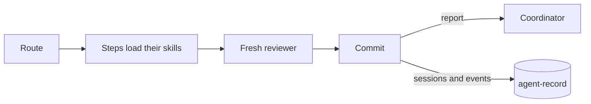
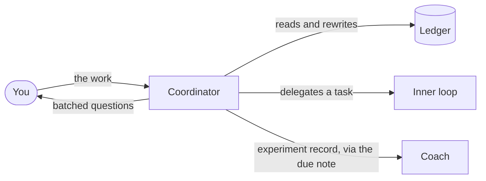
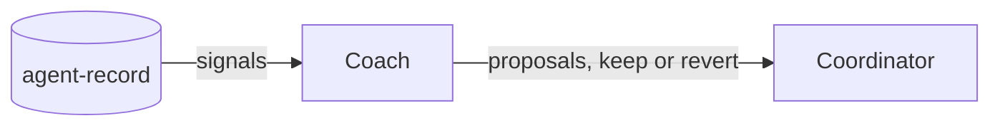

# The loops

The workflow runs in three loops, as the [README](../README.md#three-loops) shows at a glance. Each chart here shows one loop and its handoffs to the others.

## The inner loop

One agent runs one task, from its route to a landed commit.

## The outer loop

The coordinator runs all the work in one long session on autocompaction.

## The improvement loop

The coach turns the record of past work into proposals for the coordinator.

