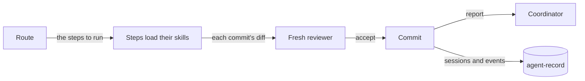
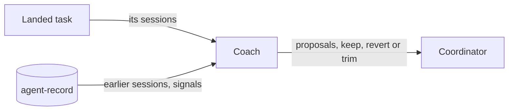
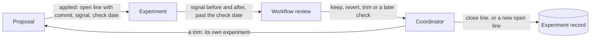

# The loops

The workflow runs in three loops. The [README chart](../README.md#three-loops) follows one task through all three; the charts here add what that chart leaves out.

## The inner loop

One agent runs one task, from its route to a landed commit.



### How a task runs

Start a task with `/task <task>`, or `/cniska-skills:task <task>` with [the plugin](plugin.md).

[task](../skills/workflow/task/SKILL.md) picks the route by what the task changes and loads each step's skill as the step starts, since a skill only helps when something loads it; its routes are the reference. Each commit waits on the [reviewer](reviewer.md).

`<task>` is what you would tell a colleague, in your own words: one line, an issue to fix, or a brief from a coordinating agent. The route reads the code the task names and works out the rest. A task whose shape is unclear starts with `plan`, which asks before it builds.

```text
/task fix issue #25                          → Bug fix
/task add a --json flag to the sync command  → Feature
/task split the config module by concern     → Refactor
/task cover the retry limit with a test      → Test
/task review PR #41                          → Review
```

## The outer loop

The coordinator runs all the work in one long session on autocompaction; the [README chart](../README.md#three-loops) shows its handoffs.

- [coordinate](../skills/workflow/coordinate/SKILL.md) runs it.
- It takes every choice it can recommend, and asks me only product tradeoffs and what it cannot answer.
- It [reports](../skills/workflow/coordinate/references/report.md) what is in flight.
- It keeps its state in a [ledger](plugin.md#ledger-hook), so a session that dies, or moves to another machine or account, resumes from it.

## The improvement loop

The workflow changes only on evidence, and a change stays only if it helps. The coach, a task coach, runs [workflow-review](../skills/workflow/workflow-review/SKILL.md) over each task once it lands to find what to change, and the coordinator applies each change as an [experiment](../skills/workflow/coordinate/references/experiments.md), with the signal it should move and a check date, unless no signal can read it.



On the check date, the signal before and after the change decides whether it stays or is reverted or trimmed:



An eval I approve can check a change before it lands, and the signals judge it after.

### Signals

The signals count the friction I feel, per week, repo and route; owner interrupts and time to land weigh most.

- **Owner interrupts:** how often I had to answer, correct or unblock an agent.
- **Time to land:** from my request to the commit on the remote.
- **Review loops:** reviewer runs per commit.
- **Stranded work:** commits not on the remote within an hour of being made.
- **False stops:** a gate that refused work which then went on with nothing the gate checks changed.

[agent-record's spec](https://github.com/cniska/agent-record/blob/main/SPEC.md) defines each signal exactly. [agent-record](https://github.com/cniska/agent-record) brings the evidence: the sessions, the hook events, and the signals counted from them. A proposal stands only when the record shows the friction it answers, or the ledger names the gap.

### What the loop changes

The loop changes skills, agents, hooks and checks on its own; anything else comes to me as a conflict, as [workflow-review](../skills/workflow/workflow-review/SKILL.md) lists.

### Lean practice

It follows lean practice, in plain terms first:

- The skills are the standard way of working, and every change the coordinator makes to them that a signal can measure is tried as an experiment (kaizen).
- Each finding names what it cost and is traced back to a skill line, a repo rule, a check or a missing tool (waste, 5 whys).
- Rules become checks, as [principles](conventions.md#principles) says, and a gate that stops correct work counts against the gate (jidoka, false stops).
- An agent that hits a defect stops and reports it rather than working around it, the stop-the-line rule in [debug](../skills/workflow/debug/SKILL.md) (andon).

[waste-and-cause.md](../skills/workflow/workflow-review/references/waste-and-cause.md) has the detail.
