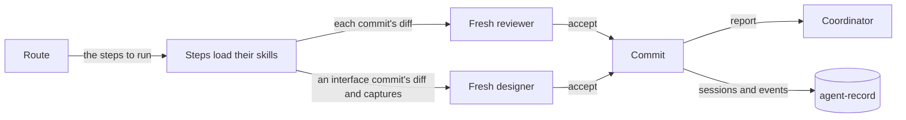
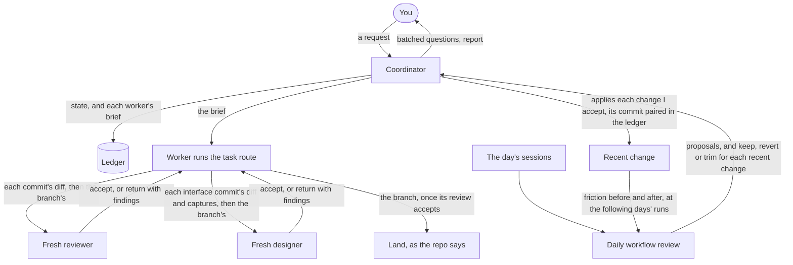
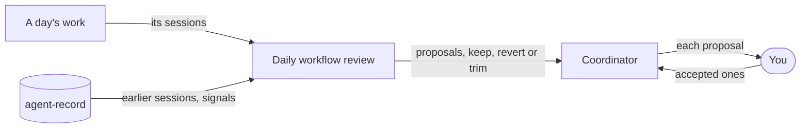

# The loops

The workflow runs in three loops. The [README chart](../README.md#three-loops) follows one task through all three; the charts here add what that chart leaves out.

## The inner loop

One agent runs one task, from its route to a landed branch.



### How a task runs

Start a task with `/task <task>`, or `/cniska-skills:task <task>` with [the plugin](plugin.md).

[task](../skills/workflow/task/SKILL.md) picks the route by what the task changes and loads each step's skill as the step starts, since a skill only helps when something loads it; its routes are the reference. Each commit waits on the [reviewer](reviewer.md), and each one that changes an interface on a [designer](plugin.md#designer-agent) too. Before a branch lands, a fresh designer judges its finished interface whole.

`<task>` is what you would tell a colleague, in your own words: one line, an issue to fix, or a brief from a coordinating agent. The route reads the code the task names and works out the rest. A task whose shape is unclear starts with `plan`, which asks before it builds.

```text
/task fix issue #25                          → Bug fix
/task add a --json flag to the sync command  → Feature
/task split the config module by concern     → Refactor
/task cover the retry limit with a test      → Test
/task review PR #41                          → Review
```

## The outer loop

The coordinator runs all the work in one long session on autocompaction, from my request to the changes the daily workflow review proposes.



- [coordinate](../skills/workflow/coordinate/SKILL.md) runs it.
- It takes every choice it can recommend, and asks me only product tradeoffs and what it cannot answer.
- It [reports](../skills/workflow/coordinate/SKILL.md#report) what is in flight.
- It keeps its state in a [ledger](plugin.md#ledger-hook), so a session that dies, or moves to another machine or account, resumes from it.

## The improvement loop

The workflow changes only on evidence, and a change stays only if it helps. A routine I schedule myself, written with [routine-writing](../skills/workflow/routine-writing/SKILL.md), runs [workflow-review](../skills/workflow/workflow-review/SKILL.md) over each day's work to find what to change; the plugin schedules nothing. Each proposal rests on evidence that clearly shows its gain, not on guesswork. The coordinator whose ledger covers the skills and tools puts each proposal to me and applies only the ones I accept.



Over the following days, each review compares the friction a recent change aimed at before and after it landed, and proposes its revert or trim when it did not help. An eval I approve can check a change before it lands, and the signals judge it after.

### Signals

The signals count the friction I feel, per week, repo and route; owner interrupts and time to land weigh most.

- **Owner interrupts:** how often I had to answer, correct or unblock an agent.
- **Time to land:** from my request to the commit being reachable from `origin/main`.
- **Review loops:** reviewer runs per commit.
- **Stranded work:** commits not reachable from `origin/main` within an hour of being made.
- **False stops:** a gate that refused work which then went on with nothing the gate checks changed.

[agent-record's spec](https://github.com/cniska/agent-record/blob/main/SPEC.md) defines each signal exactly. [agent-record](https://github.com/cniska/agent-record) brings the evidence: the sessions, the hook events, and the signals counted from them. A proposal stands only when the record shows the friction it answers, or the ledger names the gap.

### What the loop changes

The loop proposes changes to skills, agents, hooks, checks and repo rules, and none lands until I accept it; a change that crosses my boundary, as [workflow-review](../skills/workflow/workflow-review/SKILL.md) lists, comes as a conflict naming the decision I have to make.

### Lean practice

It follows lean practice, in plain terms first:

- The skills are the standard way of working, changed in small steps the evidence supports and reverted when the signals show no gain (kaizen).
- Each finding names what it cost and is traced back to a skill line, a repo rule, a check or a missing tool (waste, 5 whys).
- Rules become checks, as [principles](conventions.md#principles) says, and a gate that stops correct work counts against the gate (jidoka, false stops).
- An agent that hits a defect stops and reports it rather than working around it, the stop-the-line rule in [debug](../skills/workflow/debug/SKILL.md) (andon).

[waste-and-cause.md](../skills/workflow/workflow-review/references/waste-and-cause.md) has the detail.
