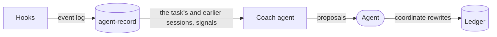
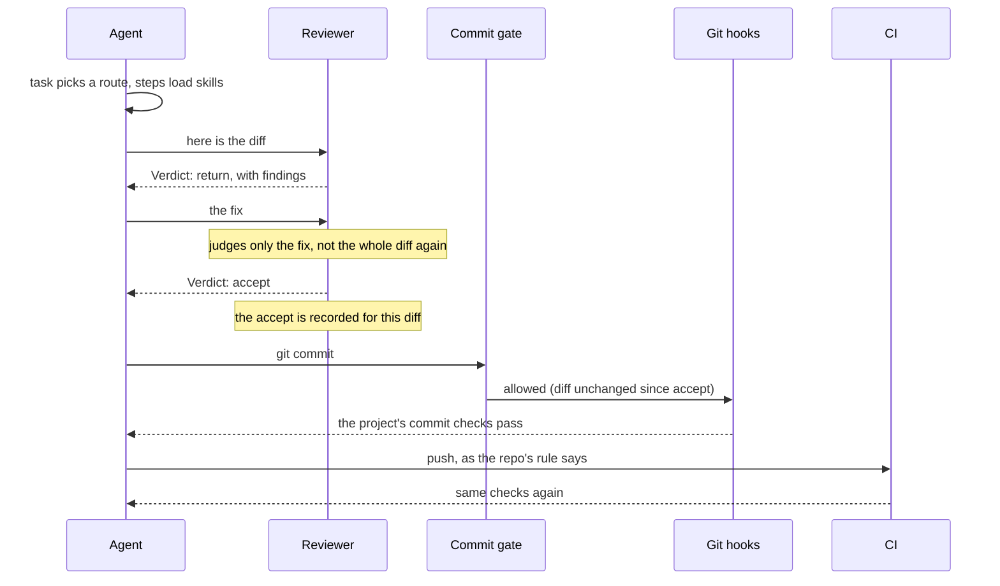

# The plugin

This repo is also `cniska-skills`, a Claude Code plugin; the [README](../README.md#install) says how to install it. It bundles every skill, with the `cniska-skills:` prefix, plus the hooks and agents below.

## How the parts fit

The optional [agent-record](https://github.com/cniska/agent-record), [agent-worktree](https://github.com/cniska/agent-worktree) and [agent-gates](https://github.com/cniska/agent-gates) sit beside the plugin.

What an agent starts with:

What it leaves behind:

One commit, start to finish, through the plugin's reviewer and commit gate and agent-gates' git hooks and CI checks:

## Session-start hook

It sends every task through `task`, so a plain prompt takes the same route as `/task`.

- A new session is told to start each task with `cniska-skills:task`, to load other skills only as a route directs, and that a commit changing code waits for the reviewer's accept.
- A resumed, forked or compacted session is told to load `coordinate` again and resume its ledger and workers when it coordinates other agents, or else to reload `task` and re-enter its route.

## Reviewer agent

`cniska-skills:reviewer` judges a design or a change it did not write, as [the reviewer](reviewer.md) says.

- It runs [design-review](../skills/expertise/design-review/SKILL.md) read-only, with its skills preloaded, since a subagent starts without the parent's.
- It ends each report with `Verdict: accept` or `Verdict: return`, naming the repo it judged on a `Repo:` line above it.

## Commit gate

It blocks a commit until the reviewer has accepted that exact diff, in the worktree the commit targets.

- An edit after the accept, or a `Verdict: return`, blocks it again.
- A diff that changes only Markdown needs no accept.
- The accept counts for the repo the reviewer named, so a session can have a change in another repo reviewed.

## Ledger hook

It prints the [coordinate](../skills/workflow/coordinate/SKILL.md) ledger into context whenever a session starts, clears, resumes, forks or compacts, for the [outer loop](loops.md#the-outer-loop).

- The ledger holds open work, owner decisions, questions waiting on the owner, and a running line per worker naming its brief, filed beside it.
- When git tracks the ledger, the hook first fast-forwards its checkout from the remote, under a five-second deadline.
- When it could not (offline, diverged, uncommitted changes), it says so and says how far behind the printed ledger is.
- Experiments go in `experiments.jsonl` beside it, one line each time one opens or closes, so agent-record can archive them.
- It lives at `~/.local/state/agent-skills/ledger.md` by default (under `$XDG_STATE_HOME` when that is set to an absolute path).
- Set `AGENT_LEDGER` to keep it elsewhere, such as a file in a repo you choose, so it outlives the machine.

## Coach agent

`cniska-skills:coach` is a task coach: once a task lands, it finds where the workflow failed me in that task and proposes fixes, for the [improvement loop](loops.md#the-improvement-loop).

- It runs [workflow-review](../skills/workflow/workflow-review/SKILL.md) over the task's sessions, the worker's and its subagents': my corrections, the questions I had to ask, gate stops, review returns, retries and the friction the sessions reported.
- It proposes only the changes that repeat: for each piece of friction it searches earlier sessions, through [agent-record](https://github.com/cniska/agent-record) where it is installed, and a first sighting proposes nothing.
- It proposes changes only to what I commit to; friction with a skill installed from elsewhere becomes a rule in the repo's `AGENTS.md`.
- It checks each open experiment past its check date in the record its brief names (the `experiments.jsonl` beside the ledger, named by the task coach hook), as workflow-review's [experiments reference](../skills/workflow/workflow-review/references/experiments.md) says.
- It proposes keeping, reverting or trimming the change, a later check date when there is not enough data, or a new start date, with an install if needed, when the change was not installed yet.
- Signals and the experiment checks that need agent-record say so and are skipped without it.
- It changes nothing itself and runs only read commands and `agent-record sync`.
- It ends each report with `Proposals: <n>`; a stop hook keeps it running once until it does.

## Task coach hook

A subagent stop hook runs the coach at the end of every delegated task.

- When a subagent that loaded `task` stops, the hook keeps it running once and asks it to run the coach over its own task before it hands back, naming its agent, session and transcript.
- It names the open experiments past their check date and where the record is, when `experiments.jsonl` sits beside the ledger.
- It skips a subagent that already ran the coach.
- The worker hands back the coach's report with its own, and its caller applies the proposals, opening an experiment for each change, and brings me only conflicts.
- No hook sees a task end in the main session, so `task` runs the coach there as its last step.

## Event log

The hooks append what a session transcript does not show plainly to `events.jsonl` in the plugin's data directory, for [agent-record](https://github.com/cniska/agent-record) to archive.

- It holds each commit-gate and verdict-check decision with a fixed reason code, each reviewer verdict, each permission prompt and each auto-mode denial.
- A hook that cannot write the line says so on stderr and decides as it would have.
- [`hooks/events.md`](../hooks/events.md) is the format.

## Optional companions

`cniska-skills` works without any of them.

### cniska-record

It keeps the [agent-record](https://github.com/cniska/agent-record) session record current and points the agent at it.

- Whenever a session starts, resumes, clears or compacts, it runs `agent-record sync` in the background and adds a note to search the record before acting on a handoff, plan or memory.
- `search-sessions` asks that record first.
- It does nothing unless the agent-record CLI is on PATH.
- Install it with `claude plugin install cniska-record@cniska`.

### cniska-worktree

It gives each task its own checkout through the [agent-worktree](https://github.com/cniska/agent-worktree) CLI.

- Whenever a session starts, resumes, clears or compacts, it adds a note telling the agent to create and remove task worktrees with the CLI.
- Its `WorktreeCreate` and `WorktreeRemove` hooks send Claude Code's own worktrees through the CLI too.
- Install the CLI first, then `claude plugin install cniska-worktree@cniska`.

### cniska-gates

It reports the comments each edit adds, in the words of the [agent-gates](https://github.com/cniska/agent-gates) no-comments gate, before the commit hook refuses them.

- The committed git hooks still gate every contributor.
- It does nothing in a repo without the gate.
- Install it with `claude plugin install cniska-gates@cniska`.
