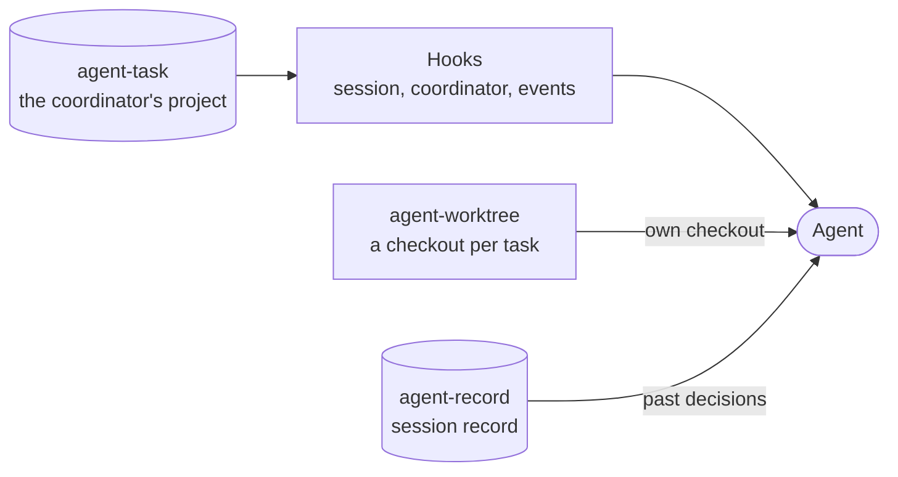
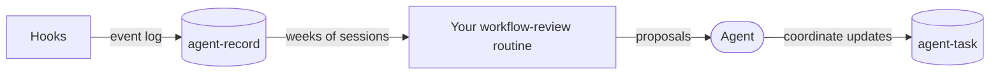
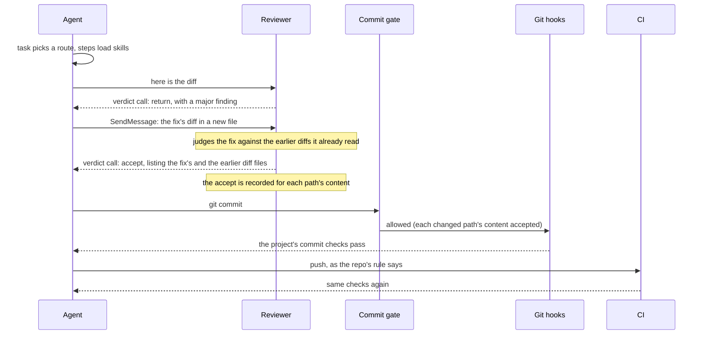

# The plugin

This repo is also `cniska-skills`, a Claude Code plugin; the [README](../README.md#install) says how to install it. It bundles every skill, with the `cniska-skills:` prefix, plus the hooks, agents and report server below.

## How the parts fit

The [optional tools](../README.md#optional-tools) the README lists sit beside the plugin.

What an agent starts with:

What it leaves behind:

One commit, start to finish, through the plugin's reviewer and commit gate and agent-gates' git hooks and CI checks:

## Session-start hook

It sends every task through `task`, so a plain prompt takes the same route as `/task`.

- A new session is told to start each task with `cniska-skills:task`, to load other skills only as a route directs, and that a commit changing code waits for the reviewer's accept, a recorded ruling's accept, or a return with only minor findings and no conflict.
- A resumed or forked session is told to load `coordinate` again and resume its project's tasks and workers when it coordinates other agents, or else to reload `task` and re-enter its route.
- A compacted session is told nothing: the host re-attaches the skills it loaded after the summary, and the hook runs before that re-attachment is written, so it cannot tell when one was dropped.

## Worker agent

`cniska-skills:worker` carries one task a [coordinate](../skills/workflow/coordinate/SKILL.md) session delegates, from its brief to the landed commit, as [its agent file](../agents/worker.md) says. It starts with [task](../skills/workflow/task/SKILL.md) and [principles](../skills/expertise/principles/SKILL.md) preloaded and no other skill, and loads each step's skill as `task` directs.

It names the tools its tasks call and no others, since every tool definition it carries, and every deferred tool's name, is re-read on each model call.

| Tools | Used for |
|---|---|
| `Bash`, `Read`, `Edit`, `Write` | Edit and commit |
| `Agent`, `SendMessage` | Start the reviewer, designer and researcher agents and answer its coordinator |
| `ListAgents` | Find the sessions a repo's rules say to message |
| `Skill` | Load each step's skill |
| `Monitor`, `TaskStop` | Long runs |
| `WebFetch`, `WebSearch` | Docs |
| `update_plan` | The host's task list |
| `SubagentHandback` | Hand back to its coordinator |
| `task_report`, `read_report` | State its final report and read its reviewers' reports, through the [report server](#report-server) |
| The built-in browser, iOS Simulator and Chrome DevTools servers, whole | Verification, each deferred tool loaded through `ToolSearch` |

It has no other MCP tool, such as Slack or Linear, so a task that needs one goes to a session that has it.

## Reviewer agent

`cniska-skills:reviewer` judges a design or a change it did not write, as [the reviewer](reviewer.md) says.

- It works read-only and preloads only `principles`. By a commit's file paths it loads [design-review](../skills/expertise/design-review/SKILL.md) for code and [doc-review](../skills/expertise/doc-review/SKILL.md) for docs.
- It judges a coordinator's brief or plan as [the reviewer](reviewer.md) says, and loads [review](../skills/workflow/review/SKILL.md) for a whole branch.
- It reports once through the [report server](#report-server)'s `verdict` tool, one judgment per repo, each naming its `repo`, and then hands back a one-line pointer.
- A report off the schema, an accept with any finding, a listed diff it did not read, or an accept whose diffs match nothing in its `repo` while another worktree holds them, is sent back to it once before it may stop. That last one is told to name that worktree as its `repo`.
- An accept whose diffs match no checkout is stored with a note and not recorded. So is one in the same round as its reviewer's return there with a critical or major finding, a conflict or a malformed judgment, where a round is one run of the reviewer, from its start or resume to its hand-back. An accept from a reviewer that returned the same change in an earlier round is recorded like any other. The change's author never reaches the tool, since only the reviewer and the designer may call `verdict` and the reviewer's tools only read.
- Its stored report, like a designer's, carries two numbers for that agent since its last recorded accept: its returns of any severity and its returns with a critical or major finding. `task` reads the number its review uses to stop the review at the third. [The hook reference](../hooks/events.md) says which returns count.

## Designer agent

`cniska-skills:designer` judges a change to a running interface it did not make, as [its agent file](../agents/designer.md) says.

- It runs [ui-review](../skills/expertise/ui-review/SKILL.md) read-only on each commit that changes an interface, with `ui-review`, [ui-design](../skills/expertise/ui-design/SKILL.md), `search-sessions` and `principles` preloaded, and reads a platform reference of `ui-design` only for a screen on that platform.
- It also judges a branch's finished interface whole, once, before the branch lands.
- Its shell only reads, and syncs the session record, where it looks up the owner's past UI corrections.
- It reports through the same `verdict` tool, with the reasons its agent file lists. The commit gate does not record its verdicts, so a designer accept never stands in for the reviewer's; [task](../skills/workflow/task/SKILL.md) is what makes an interface commit wait for it.

## Researcher agent

`cniska-skills:researcher` answers [second-opinion](../skills/workflow/second-opinion/SKILL.md) read-only, as [its agent file](../agents/researcher.md) says, and reports through the `research` tool, whose `sort` is `proposal`, `idea` or `drop` with its reason.

## Report server

It serves the agents' report tools from `mcp/`, as the MCP server `report` that `.mcp.json` starts: `verdict`, `research` and `task_report` take a report as data, `ruling` takes a [ruling](#rulings), and `read_report` returns one stored report by its agent id, or a top-level worker's by its session id.

- **Checked before the call:** the plugin's `PreToolUse` hook checks each `verdict`, `research` or `task_report` call against [the schemas](../mcp/report-schemas.json) and its caller, stores it under the plugin's data directory, and allows it without a permission prompt. A call off the schema is denied once and one from the wrong agent every time, each naming the fix; [hook events](../hooks/events.md) lists the codes. A `ruling` is checked and logged, never stored, as [Rulings](#rulings) says.
- **Rule names:** each `rule` in a verdict's findings, conflicts and follow-ups must be one of the names in [`hooks/rule-names.json`](../hooks/rule-names.json), which `mise run rule-names` reads from the skills' rule headings. A call naming another is denied once with every name listed; a second such call is stored as not recorded.
- **Once per hand-back:** a second report call before the hand-back is refused. A reviewer, designer, researcher or worker that ends with no report since its last hand-back is sent back once; handing back a report resets that, so a resumed agent reports again and its report replaces the old. One that still ends without reporting leaves no report to read.
- **Waiting on a re-review:** an agent that resumes one with a stored report through `SendMessage` keeps running while it waits. Its end is held until that agent hands back, up to four minutes, then sent back to read the verdict, or to wait again. A send that fails or is denied starts no wait, and a wait lapses after 30 minutes.
- **Read back:** the caller reads the report through `read_report`, never from the agent's closing message.

## Commit gate

It blocks a commit until the reviewer or a recorded ruling has accepted the content of every changed code path, in the worktree the commit targets, or the reviewer returned it with only minor findings and no conflict.

- It judges each code path that `git diff --cached` lists against `HEAD` or whose working-tree file differs from `HEAD`, an untracked file that git does not ignore included, on each side that differs: the staged content and the working-tree file, since a commit hook, a pathspec or `-a` can carry either. A path added with `git add -N` has a working side only, since `git diff --cached` does not list it. A side is covered while its mode and content are the new side of that path in a diff file the reviewer read and listed in its `verdict` call's `diffs`, and a deleted side only by an accepted deletion or a minor-only return's cover. A commit carrying anything else is blocked, and the refusal names each uncovered path and side.
- The accept holds per path, not for the whole diff, so an accepted diff can land over several commits, and an unrelated edit, or an untracked file, set aside with `git stash` or `git stash -u` and restored after the commit voids no accept. It lapses for a path once a commit after the accept touches that path, or once the commit it was recorded on is no longer an ancestor of `HEAD`, as after an amend, rebase or reset, so accepted content landed again after a later change needs a fresh accept, and a return voids the accept of each path in every diff file its reviewer read, leaving the repo's other accepts standing.
- **Minor-only return:** a reviewer's return of minor findings alone and no conflict covers paths whatever their content, so the fix commits without a re-review.
  - **Covers:** each path whose new side the repo holds in the diff files its reviewer listed, and each path in the repo a finding cites. A fix that touches any other path needs an accept for it.
  - **Ends:** when `HEAD` next moves or at the repo's next return, so a later edit needs a review again. A return before the first commit, or with `HEAD`'s reflog off, covers nothing.
  - **Never:** from a reviewer that returned the repo with a critical or major finding, a conflict or a malformed judgment earlier in the same round. Resumed on the fix, its minor-only return covers as a new reviewer's would.
- Accepts merge: a later accept adds the paths its reviewer read, and a re-review covers the whole change when its reviewer also lists the change's earlier diff files, which a resumed reviewer has already read.
- A re-review, needed after any return with a critical or major finding or a conflict, goes to the reviewer that returned the change, resumed through `SendMessage`. Only when that reviewer is gone, as after a session restart, does a new one take over, briefed with the earlier returns and the fix.
- A finding about code outside every diff of the change, on an older problem that blocks the change, is fixed in a commit of its own, accepted alone before the returned change, whose re-review then names that commit's diff as the fix; the change's diff keeps to its own paths. A defect there that was there before the change and does not block it goes under follow-ups, which never hold back an accept.
- Markdown, and a path that `HEAD`'s `.gitattributes` files mark `linguist-generated`, is not code: the gate never judges it, so a change to only such paths needs no accept, before or after one.
- Only a marking committed in `HEAD` counts, so a `.gitattributes` change exempts paths from the next commit on, and a `.gitattributes` file is never exempt; the refusal names this route, a `.gitattributes` change committed alone and reviewed first. No path counts as generated while the repo's `info/attributes` holds a rule, before the first commit, or when `git check-attr` fails.
- The accept counts for the repo the reviewer named, so a session can have a change in another repo reviewed.
- A command that creates its repo with `git init` or `git clone` under a temp directory and commits there passes, as a scratch experiment; a repo created anywhere else blocks the commit. A command run from outside a temp directory reaches one with `-C` and a literal temp path on every commit, or with a leading `cd` to a literal temp path or to `"$(mktemp -d)"`, joined to every later step by `&&`; on the `cd` route, a target named through a variable, or a `;` or newline before the last commit, blocks the command.
- Quoted strings and heredoc bodies are read as text, so commit text in an `echo` or a message neither opens nor blocks the gate; a quoted path after `cd`, `pushd` or `-C` still names the repo, and a quoted string that runs as code, after `sh -c` or `eval` or holding a command substitution, is still read.

## Rulings

A coordinator rules on a review that stopped at its cap, and any top-level session can record the owner's words, through the `ruling` tool. Its `call` says which:

| Call | Means | Requires |
|---|---|---|
| `work_right` | Each finding is wrong or already fixed | `findings`, a reason for each |
| `finding_right` | The work goes back with the fix | |
| `owner_only` | Only the owner can decide | |
| `owner_decision` | The owner accepted on a stop that went to them | `owner_words` |
| `owner_instruction` | The owner told the session to commit; needs no earlier return | `owner_words`, `review` `commit` |

- **Effect:** `work_right`, `owner_decision` and `owner_instruction` on `review` `commit` also require `diffs`. The gate takes them like a reviewer's accept, for the paths in those diffs, and they lapse as a reviewer's does.
- **Every other ruling:** it adds no paths. A `branch` or `plan` ruling reaches the worker as a message, which is that review's accept. A `designer` ruling settles only the wait for the designer.
- **Refused every time:** any caller with an `agent_id` or a `cniska-skills:` `agent_type`, even a top-level worker, a call off the schema, and on a commit a diff the session's transcript does not show it read or one that matches nothing in `repo`. [Hook events](../hooks/events.md) lists the codes.
- **Not checked:** that a coordinator did not write what it rules on. That rule lives in [coordinate](../skills/workflow/coordinate/SKILL.md) and `task`.
- **On the record:** each ruling logs a `tag` with key `ruling` and its call as value, so agent-record never counts it as a review. The reasons and the owner's words stay in the tool call's input in the session transcript.

List the rulings with `agent-record sql "select ts, session, tag_value from hook_event where event = 'tag' and tag_key = 'ruling' order by ts"`.

## Coordinator hook

It prints a [coordinate](../skills/workflow/coordinate/SKILL.md) session's project and tasks into context whenever a session starts, clears, resumes, forks or compacts, for the [outer loop](loops.md#the-outer-loop).

- A coordinator is an [agent-task](https://github.com/cniska/agent-task) project. Start its session with the project id in `AGENT_TASK_PROJECT`, as in `AGENT_TASK_PROJECT=<id> claude`, from the repository the project records.
- The hook names the project and the `agent-task` commands that read and write its tasks, then prints them as `agent-task list --project <id> --full` does, refusal included.
- Before that, it fast-forwards the directory the project records, where briefs and plans live, from its remote under a five-second deadline.
- When it could not (offline, diverged, uncommitted changes), it says so and how far behind the directory is.
- A session started without `AGENT_TASK_PROJECT` gets nothing from it, and one without the agent-task CLI gets a line saying the tasks were not read. Without `jq` it prints the tasks but does not pull the directory.
- The tasks live in agent-task's store on this machine, so a coordinator resumes only on the machine and account that ran it.

## Event log

The hooks append what a session transcript does not show plainly to `events.jsonl` in the plugin's data directory, in the format [agent-record](https://github.com/cniska/agent-record) defines, for it to archive where installed.

- It holds each commit-gate and verdict-check decision with a fixed reason code, each reviewer verdict with its finding counts, each ruling, each permission prompt and each auto-mode denial.
- A hook that cannot write the line says so on stderr and decides as it would have.
- [`hooks/events.md`](../hooks/events.md) says what each hook writes.

## Optional companions

`cniska-skills` works without any of them, except that a coordinating session's [coordinator hook](#coordinator-hook) reads its tasks through the agent-task CLI.

### cniska-record

It keeps the [agent-record](https://github.com/cniska/agent-record) session record current and points the agent at it.

- Whenever a session starts, resumes, clears or compacts, it runs `agent-record sync` in the background and adds a note to search the record before acting on a handoff, plan or memory.
- `search-sessions` asks that record first.
- It does nothing unless the agent-record CLI is on PATH.
- Install it with `claude plugin install cniska-record@cniska`.

### cniska-worktree

It gives each task its own checkout through the [agent-worktree](https://github.com/cniska/agent-worktree) CLI.

- Whenever a session starts, resumes, clears or compacts, it adds a note telling the agent to create and remove task worktrees with the CLI.
- Its `WorktreeCreate` and `WorktreeRemove` hooks send Claude Code's own worktrees through the CLI too.
- Install the CLI first, then `claude plugin install cniska-worktree@cniska`.

### cniska-gates

It reports the comments each edit adds, in the words of the [agent-gates](https://github.com/cniska/agent-gates) no-comments gate, before the commit hook refuses them.

- Before each shell command, it denies a git command that would skip the gates: `--no-verify` on a commit or push, or `core.hooksPath` pointed elsewhere.
- The committed git hooks still gate every contributor.
- It does nothing in a repo without the gate.
- Install it with `claude plugin install cniska-gates@cniska`.

### cniska-task

It tells every session that queued and running work lives in the [agent-task](https://github.com/cniska/agent-task) CLI, not in a ledger, a notes file or a plan.

- Whenever a session starts, resumes, clears or compacts, it adds a note naming the commands that queue, start, hand back and close a task.
- In a directory holding the brief of a running or in-review task, it adds those tasks after the note, as `agent-task list --started` prints them, each flagged when its brief changed.
- It needs `jq` to add the tasks, and does nothing unless the agent-task CLI is on PATH.
- Install it with `claude plugin install cniska-task@cniska`.

### cniska-ship

It maps each step of the `ship` skill to the [agent-ship](https://github.com/cniska/agent-ship) command that does it: `check`, `release`, `release --dry-run` and `status <tag>`.

- Whenever a session starts, resumes, clears or compacts, it adds that map as a note.
- When a newer agent-ship is out, it adds the command that upgrades the installed copy after the note.
- It does nothing unless the agent-ship CLI is on PATH.
- Install it with `claude plugin install cniska-ship@cniska`.
