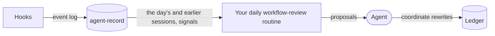
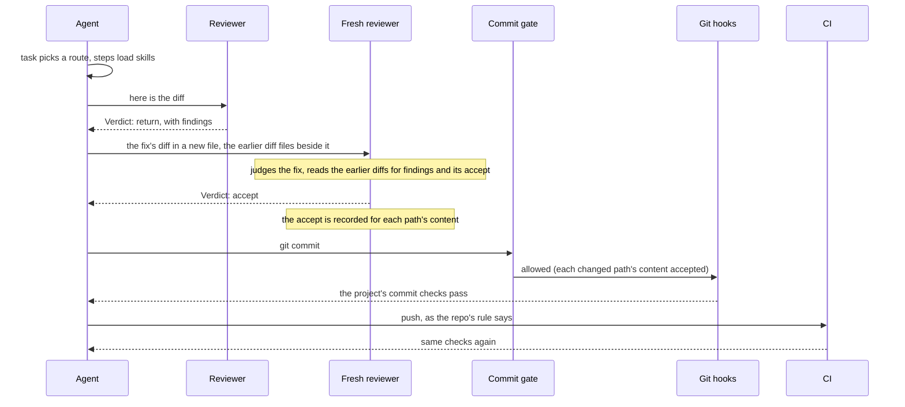

# The plugin

This repo is also `cniska-skills`, a Claude Code plugin; the [README](../README.md#install) says how to install it. It bundles every skill, with the `cniska-skills:` prefix, plus the hooks and agents below.

## How the parts fit

The [optional tools](../README.md#optional-tools) the README lists sit beside the plugin.

What an agent starts with:

What it leaves behind:

One commit, start to finish, through the plugin's reviewer and commit gate and agent-gates' git hooks and CI checks:

## Session-start hook

It sends every task through `task`, so a plain prompt takes the same route as `/task`.

- A new session is told to start each task with `cniska-skills:task`, to load other skills only as a route directs, and that a commit changing code waits for the reviewer's accept.
- A resumed or forked session is told to load `coordinate` again and resume its ledger and workers when it coordinates other agents, or else to reload `task` and re-enter its route.
- A compacted session is told nothing: the host re-attaches the skills it loaded after the summary, and the hook runs before that re-attachment is written, so it cannot tell when one was dropped.

## Worker agent

`cniska-skills:worker` carries one task a [coordinate](../skills/workflow/coordinate/SKILL.md) session delegates, from its brief to the landed commit, as [its agent file](../agents/worker.md) says.

- It starts with [task](../skills/workflow/task/SKILL.md) and [principles](../skills/expertise/principles/SKILL.md) preloaded and no other skill, and loads each step's skill as `task` directs.
- It inherits every tool, since it edits, commits and starts the reviewer and researcher agents.

## Reviewer agent

`cniska-skills:reviewer` judges a design or a change it did not write, as [the reviewer](reviewer.md) says.

- It runs [design-review](../skills/expertise/design-review/SKILL.md) on each commit read-only, with its skills preloaded, since a subagent starts without the parent's, and loads [review](../skills/workflow/review/SKILL.md) for the review of a whole branch.
- It ends each report with `Verdict: accept` or `Verdict: return`, naming the repo it judged on a `Repo:` line above it; a change across repos ends with one such pair per repo.
- Its report holds the sections `## Findings`, `## Conflicts`, `## Follow-ups` and `## Clean`; a report missing one, an accept with any finding under `## Findings`, an accept from a reviewer that never read a diff file its brief names, or an accept whose diff files name paths none of which matches the index or working tree of the checkout its `Repo:` line names, is sent back to it once before it may stop. That last one is told to name the worktree that holds those paths on its `Repo:` line, or, where no worktree does, to ask for a fresh diff of the change.

## Researcher agent

`cniska-skills:researcher` answers [second-opinion](../skills/workflow/second-opinion/SKILL.md) read-only, as [its agent file](../agents/researcher.md) says, and ends with `Sort: proposal`, `Sort: idea` or `Sort: drop: <reason>`.

## Commit gate

It blocks a commit until the reviewer has accepted the content of every changed code path, in the worktree the commit targets.

- It judges each code path that `git diff --cached` lists against `HEAD` or whose working-tree file differs from `HEAD`, an untracked file that git does not ignore included, on each side that differs: the staged content and the working-tree file, since a commit hook, a pathspec or `-a` can carry either. A path added with `git add -N` has a working side only, since `git diff --cached` does not list it. A side is covered while its mode and content are the new side of that path in a diff file a reviewer read that the brief names by absolute path, and a deleted side only by an accepted deletion. A commit carrying anything else is blocked, and the refusal names each uncovered path and side.
- The accept holds per path, not for the whole diff, so an accepted diff can land over several commits, and an unrelated edit, or an untracked file, set aside with `git stash` or `git stash -u` and restored after the commit voids no accept. It lapses for a path once a commit after the accept touches that path, or once the commit it was recorded on is no longer an ancestor of `HEAD`, as after an amend, rebase or reset, so accepted content landed again after a later change needs a fresh accept, and a `Verdict: return` voids the accept of each path in a diff file its brief names by absolute path, leaving the repo's other accepts standing.
- Accepts merge: a later accept adds the paths its reviewer read, and a re-review covers the whole change when its brief also names the change's earlier diff files by absolute path.
- An accept from a reviewer that returned the same repo earlier is discarded, so a re-review is always a fresh reviewer.
- A finding about code outside every diff of the change that blocks the change is fixed in a commit of its own, accepted alone before the returned change, whose re-review then names that commit's diff as the fix; the change's diff keeps to its own paths. A defect there that does not block the change goes under `## Follow-ups`, which never holds back an accept.
- A path that `HEAD`'s `.gitattributes` files mark `linguist-generated` is not code: the gate never judges it, so a change to only such paths needs no accept, before or after one.
- Only a marking committed in `HEAD` counts, so a `.gitattributes` change exempts paths from the next commit on, and a `.gitattributes` file is never exempt; the refusal names this route, a `.gitattributes` change committed alone and reviewed first. No path counts as generated while the repo's `info/attributes` holds a rule, before the first commit, or when `git check-attr` fails.
- The accept counts for the repo the reviewer named, so a session can have a change in another repo reviewed.
- A command that creates its repo with `git init` or `git clone` under a temp directory and commits there passes, as a scratch experiment; a repo created anywhere else blocks the commit. A command run from outside a temp directory reaches one with `-C` and a literal temp path on every commit, or with a leading `cd` to a literal temp path or to `"$(mktemp -d)"`, joined to every later step by `&&`; on the `cd` route, a target named through a variable, or a `;` or newline before the last commit, blocks the command.
- Quoted strings and heredoc bodies are read as text, so commit text in an `echo` or a message neither opens nor blocks the gate; a quoted path after `cd`, `pushd` or `-C` still names the repo, and a quoted string that runs as code, after `sh -c` or `eval` or holding a command substitution, is still read.

## Brief gate

It refuses to start the reviewer on a brief the reviewer cannot read, since the reviewer has no shell.

- It reads only the prompt of an `Agent` start whose `subagent_type` is `cniska-skills:reviewer`; every other start passes.
- A prompt naming a `.diff` or `.log` file by anything but an absolute path, such as a bare name, a relative path or a `~` path, is refused, and the refusal names each such file. It splits the prompt into paths the way the commit gate reads a brief, so each one it lets through is a path the commit gate reads too.
- A prompt holding `git show`, `git -C`, `git diff`, or a `git log` with `-p` or `--patch` is refused, and the refusal says to write each command's output to a file in the temp folder and name the file by its absolute path.
- A prompt holding both is refused once, naming each.
- Input it cannot read passes, and so does every start when `jq` does not run, each with a line on stderr naming the cause.

## Ledger hook

It prints the [coordinate](../skills/workflow/coordinate/SKILL.md) ledger into context whenever a session starts, clears, resumes, forks or compacts, for the [outer loop](loops.md#the-outer-loop).

- The ledger holds what coordinate's ledger step lists, its briefs filed in the ledger's folder: beside the shared file it links, else beside the ledger.
- When git tracks the ledger, the hook first fast-forwards its checkout from the remote, under a five-second deadline.
- When it could not (offline, diverged, uncommitted changes), it says so and says how far behind the printed ledger is.
- When the ledger's first line links a shared file, it prints that file after the ledger, pulled the same way, so the owner's standing rules survive compaction too.
- Experiments go in `experiments.jsonl` in the ledger's folder, one line each time one opens or closes, so agent-record can archive them.
- By default each project has its own, at `~/.local/share/agent-skills/<project>/ledger.md` (under `$XDG_DATA_HOME` when that is set to an absolute path), `<project>` being the git common directory, minus `/.git`, slashes as dashes: the main checkout for a normal repo, the git directory under `.git/modules/` for a submodule, or outside git the project's directory, so all of a repo's worktrees read one ledger. The old single `agent-skills/ledger.md` under the state directory is no longer read.
- When the ledger is missing, it prints the path it would read, so a coordinating session creates the ledger there.
- Set `AGENT_LEDGER` in a project's local settings to keep its ledger elsewhere, such as a file in a repo you choose, so it outlives the machine; never in user settings, which every project reads.

## Event log

The hooks append what a session transcript does not show plainly to `events.jsonl` in the plugin's data directory, in the format [agent-record](https://github.com/cniska/agent-record) defines, for it to archive where installed.

- It holds each commit-gate and verdict-check decision with a fixed reason code, each reviewer verdict with its finding counts, each permission prompt and each auto-mode denial.
- A hook that cannot write the line says so on stderr and decides as it would have.
- [`hooks/events.md`](../hooks/events.md) says what each hook writes.

## Optional companions

`cniska-skills` works without any of them.

### cniska-record

It keeps the [agent-record](https://github.com/cniska/agent-record) session record current and points the agent at it.

- Whenever a session starts, resumes, clears or compacts, it runs `agent-record sync` in the background and adds a note to search the record before acting on a handoff, plan or memory.
- `search-sessions` asks that record first.
- It does nothing unless the agent-record CLI is on PATH.
- Install it with `claude plugin install cniska-record@cniska`.

### cniska-worktree

It gives each task its own checkout through the [agent-worktree](https://github.com/cniska/agent-worktree) CLI.

- Whenever a session starts, resumes, clears or compacts, it adds a note telling the agent to create and remove task worktrees with the CLI.
- Its `WorktreeCreate` and `WorktreeRemove` hooks send Claude Code's own worktrees through the CLI too.
- Install the CLI first, then `claude plugin install cniska-worktree@cniska`.

### cniska-gates

It reports the comments each edit adds, in the words of the [agent-gates](https://github.com/cniska/agent-gates) no-comments gate, before the commit hook refuses them.

- Before each shell command, it denies a git command that would skip the gates: `--no-verify` on a commit or push, or `core.hooksPath` pointed elsewhere.
- The committed git hooks still gate every contributor.
- It does nothing in a repo without the gate.
- Install it with `claude plugin install cniska-gates@cniska`.

### cniska-task

Whenever a session starts, resumes, clears or compacts in a directory that holds a running task's brief, it adds the tasks the [agent-task](https://github.com/cniska/agent-task) CLI runs, as `agent-task list` prints them, to the session's context.

- It needs `jq` and `realpath`, and does nothing unless the agent-task CLI is on PATH.
- Install it with `claude plugin install cniska-task@cniska`.
