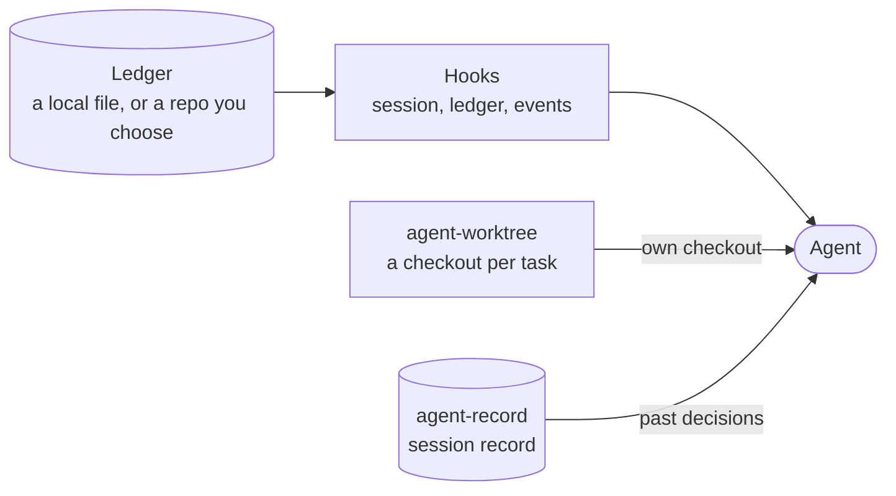
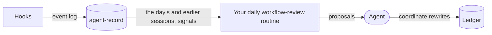
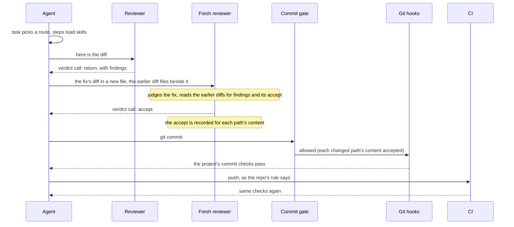

# The plugin

This repo is also `cniska-skills`, a Claude Code plugin; the [README](../README.md#install) says how to install it. It bundles every skill, with the `cniska-skills:` prefix, plus the hooks, agents and report server below.

## How the parts fit

The [optional tools](../README.md#optional-tools) the README lists sit beside the plugin.

What an agent starts with:

What it leaves behind:

One commit, start to finish, through the plugin's reviewer and commit gate and agent-gates' git hooks and CI checks:

## Session-start hook

It sends every task through `task`, so a plain prompt takes the same route as `/task`.

- A new session is told to start each task with `cniska-skills:task`, to load other skills only as a route directs, and that a commit changing code waits for the reviewer's accept.
- A resumed or forked session is told to load `coordinate` again and resume its ledger and workers when it coordinates other agents, or else to reload `task` and re-enter its route.
- A compacted session is told nothing: the host re-attaches the skills it loaded after the summary, and the hook runs before that re-attachment is written, so it cannot tell when one was dropped.

## Worker agent

`cniska-skills:worker` carries one task a [coordinate](../skills/workflow/coordinate/SKILL.md) session delegates, from its brief to the landed commit, as [its agent file](../agents/worker.md) says.

- It starts with [task](../skills/workflow/task/SKILL.md) and [principles](../skills/expertise/principles/SKILL.md) preloaded and no other skill, and loads each step's skill as `task` directs.
- It drops the built-in tools no route calls, such as `Artifact`, `NotebookEdit`, `LSP` and the cron tools, since every tool definition it carries is re-read on each model call. It keeps the shell and file tools to edit and commit, `Agent` and `SendMessage` to start the reviewer, designer and researcher agents and answer its coordinator, `ListAgents` to find the sessions a repo's rules say to message, `Skill` for each step, `Monitor` and `TaskStop` for long runs, and `WebFetch` and `WebSearch` for docs.
- It states its final report through the [report server](#report-server)'s `task_report` tool.
- It inherits every MCP tool, so whatever server a project's verify skill drives stays reachable, and `ToolSearch` keeps each one the host defers out of context until a step searches for it.

## Reviewer agent

`cniska-skills:reviewer` judges a design or a change it did not write, as [the reviewer](reviewer.md) says.

- It works read-only and preloads only `principles`. By a commit's file paths it loads [design-review](../skills/expertise/design-review/SKILL.md) for code and [doc-review](../skills/expertise/doc-review/SKILL.md) for docs.
- It judges a coordinator's brief or plan as [the reviewer](reviewer.md) says, and loads [review](../skills/workflow/review/SKILL.md) for a whole branch.
- It reports once through the [report server](#report-server)'s `verdict` tool, one judgment per repo, each naming its `repo`, and then hands back a one-line pointer.
- A report off the schema, an accept with any finding, a listed diff it did not read, or an accept whose diffs match nothing in its `repo` while another worktree holds them, is sent back to it once before it may stop. That last one is told to name that worktree as its `repo`.
- An accept whose diffs match no checkout, or one from a reviewer that returned the repo earlier, is stored with a note and not recorded.
- The stored report counts a return's place on its commit, so `task` parks a commit after its third return. One commit's returns are those from distinct reviewers on the same `HEAD` whose read diff files share a path, so a landed commit, or a change replaced by one on other paths, starts the count over.

## Designer agent

`cniska-skills:designer` judges a change to a running interface it did not make, as [its agent file](../agents/designer.md) says.

- It runs [ui-review](../skills/expertise/ui-review/SKILL.md) read-only on each commit that changes an interface, with `ui-review`, [ui-design](../skills/expertise/ui-design/SKILL.md), `search-sessions` and `principles` preloaded, and reads a platform reference of `ui-design` only for a screen on that platform.
- Its shell only reads, and syncs the session record, where it looks up the owner's past UI corrections.
- It reports through the same `verdict` tool, with the reasons its agent file lists. The commit gate does not record its verdicts, so a designer accept never stands in for the reviewer's; [task](../skills/workflow/task/SKILL.md) is what makes an interface commit wait for it.

## Researcher agent

`cniska-skills:researcher` answers [second-opinion](../skills/workflow/second-opinion/SKILL.md) read-only, as [its agent file](../agents/researcher.md) says, and reports through the `research` tool, whose `sort` is `proposal`, `idea` or `drop` with its reason.

## Report server

It serves the agents' report tools from `mcp/`, as the MCP server `report` that `.mcp.json` starts: `verdict`, `research` and `task_report` take a report as data, and `read_report` returns one stored report by its agent id, or a top-level worker's by its session id.

- **Checked before the call:** the plugin's `PreToolUse` hook checks each call against [the schemas](../mcp/report-schemas.json) and its caller, stores it under the plugin's data directory, and allows it without a permission prompt. A call off the schema is denied once and one from the wrong agent every time, each naming the fix; [hook events](../hooks/events.md) lists the codes.
- **Once per hand-back:** a second report call before the hand-back is refused. A reviewer, designer, researcher or worker that ends with no report since its last hand-back is sent back once; handing back a report resets that, so a resumed agent reports again and its report replaces the old. One that still ends without reporting leaves no report to read.
- **Read back:** the caller reads the report through `read_report`, never from the agent's closing message.

## Commit gate

It blocks a commit until the reviewer has accepted the content of every changed code path, in the worktree the commit targets.

- It judges each code path that `git diff --cached` lists against `HEAD` or whose working-tree file differs from `HEAD`, an untracked file that git does not ignore included, on each side that differs: the staged content and the working-tree file, since a commit hook, a pathspec or `-a` can carry either. A path added with `git add -N` has a working side only, since `git diff --cached` does not list it. A side is covered while its mode and content are the new side of that path in a diff file the reviewer read and listed in its `verdict` call's `diffs`, and a deleted side only by an accepted deletion. A commit carrying anything else is blocked, and the refusal names each uncovered path and side.
- The accept holds per path, not for the whole diff, so an accepted diff can land over several commits, and an unrelated edit, or an untracked file, set aside with `git stash` or `git stash -u` and restored after the commit voids no accept. It lapses for a path once a commit after the accept touches that path, or once the commit it was recorded on is no longer an ancestor of `HEAD`, as after an amend, rebase or reset, so accepted content landed again after a later change needs a fresh accept, and a return voids the accept of each path in every diff file its reviewer read, leaving the repo's other accepts standing.
- Accepts merge: a later accept adds the paths its reviewer read, and a re-review covers the whole change when its reviewer also reads and lists the change's earlier diff files.
- An accept from a reviewer that returned the same repo earlier is not recorded, so a re-review is always a fresh reviewer.
- A finding about code outside every diff of the change, on an older problem that blocks the change, is fixed in a commit of its own, accepted alone before the returned change, whose re-review then names that commit's diff as the fix; the change's diff keeps to its own paths. A defect there that was there before the change and does not block it goes under follow-ups, which never hold back an accept.
- Markdown, and a path that `HEAD`'s `.gitattributes` files mark `linguist-generated`, is not code: the gate never judges it, so a change to only such paths needs no accept, before or after one.
- Only a marking committed in `HEAD` counts, so a `.gitattributes` change exempts paths from the next commit on, and a `.gitattributes` file is never exempt; the refusal names this route, a `.gitattributes` change committed alone and reviewed first. No path counts as generated while the repo's `info/attributes` holds a rule, before the first commit, or when `git check-attr` fails.
- The accept counts for the repo the reviewer named, so a session can have a change in another repo reviewed.
- A command that creates its repo with `git init` or `git clone` under a temp directory and commits there passes, as a scratch experiment; a repo created anywhere else blocks the commit. A command run from outside a temp directory reaches one with `-C` and a literal temp path on every commit, or with a leading `cd` to a literal temp path or to `"$(mktemp -d)"`, joined to every later step by `&&`; on the `cd` route, a target named through a variable, or a `;` or newline before the last commit, blocks the command.
- Quoted strings and heredoc bodies are read as text, so commit text in an `echo` or a message neither opens nor blocks the gate; a quoted path after `cd`, `pushd` or `-C` still names the repo, and a quoted string that runs as code, after `sh -c` or `eval` or holding a command substitution, is still read.

## Ledger hook

It prints the [coordinate](../skills/workflow/coordinate/SKILL.md) ledger into context whenever a session starts, clears, resumes, forks or compacts, for the [outer loop](loops.md#the-outer-loop).

- The ledger holds what coordinate's ledger step lists, its briefs filed in the ledger's folder: beside the shared file it names, else beside the ledger.
- When git tracks the ledger, the hook first fast-forwards its checkout from the remote, under a five-second deadline.
- When it could not (offline, diverged, uncommitted changes), it says so and says how far behind the printed ledger is.
- When the ledger decodes as TOON and its root `shared` key holds a path, absolute or relative to the ledger's directory, it prints that file after the ledger, pulled the same way, so the work several coordinators share survives compaction too. It reads that key in the form the TOON encoder prints; any other ledger, such as a Markdown one, prints alone.
- By default each project has its own, at `~/.local/share/agent-skills/<project>/ledger.toon` (under `$XDG_DATA_HOME` when that is set to an absolute path), `<project>` being the git common directory, minus `/.git`, slashes as dashes: the main checkout for a normal repo, the git directory under `.git/modules/` for a submodule, or outside git the project's directory, so all of a repo's worktrees read one ledger. The old default `ledger.md` beside it, and the old single `agent-skills/ledger.md` under the state directory, are no longer read.
- When the ledger is missing, it prints the path it would read, so a coordinating session creates the ledger there.
- Set `AGENT_LEDGER` in a project's local settings to keep its ledger elsewhere, such as a file in a repo you choose, so it outlives the machine; never in user settings, which every project reads.

## Event log

The hooks append what a session transcript does not show plainly to `events.jsonl` in the plugin's data directory, in the format [agent-record](https://github.com/cniska/agent-record) defines, for it to archive where installed.

- It holds each commit-gate and verdict-check decision with a fixed reason code, each reviewer verdict with its finding counts, each permission prompt and each auto-mode denial.
- A hook that cannot write the line says so on stderr and decides as it would have.
- [`hooks/events.md`](../hooks/events.md) says what each hook writes.

## Optional companions

`cniska-skills` works without any of them.

### cniska-record

It keeps the [agent-record](https://github.com/cniska/agent-record) session record current and points the agent at it.

- Whenever a session starts, resumes, clears or compacts, it runs `agent-record sync` in the background and adds a note to search the record before acting on a handoff, plan or memory.
- `search-sessions` asks that record first.
- It does nothing unless the agent-record CLI is on PATH.
- Install it with `claude plugin install cniska-record@cniska`.

### cniska-worktree

It gives each task its own checkout through the [agent-worktree](https://github.com/cniska/agent-worktree) CLI.

- Whenever a session starts, resumes, clears or compacts, it adds a note telling the agent to create and remove task worktrees with the CLI.
- Its `WorktreeCreate` and `WorktreeRemove` hooks send Claude Code's own worktrees through the CLI too.
- Install the CLI first, then `claude plugin install cniska-worktree@cniska`.

### cniska-gates

It reports the comments each edit adds, in the words of the [agent-gates](https://github.com/cniska/agent-gates) no-comments gate, before the commit hook refuses them.

- Before each shell command, it denies a git command that would skip the gates: `--no-verify` on a commit or push, or `core.hooksPath` pointed elsewhere.
- The committed git hooks still gate every contributor.
- It does nothing in a repo without the gate.
- Install it with `claude plugin install cniska-gates@cniska`.

### cniska-task

Whenever a session starts, resumes, clears or compacts in a directory that holds a running task's brief, it adds the tasks the [agent-task](https://github.com/cniska/agent-task) CLI runs, as `agent-task list` prints them, to the session's context.

- It needs `jq` and `realpath`, and does nothing unless the agent-task CLI is on PATH.
- Install it with `claude plugin install cniska-task@cniska`.
